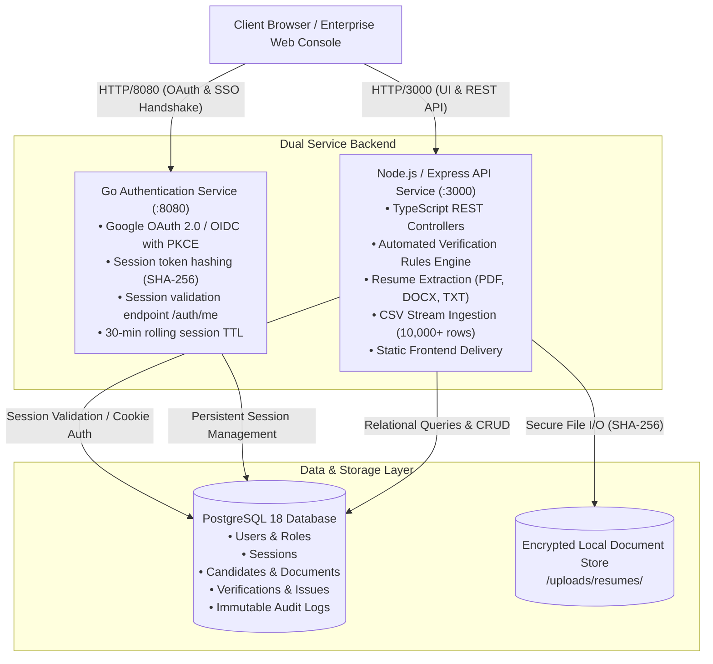
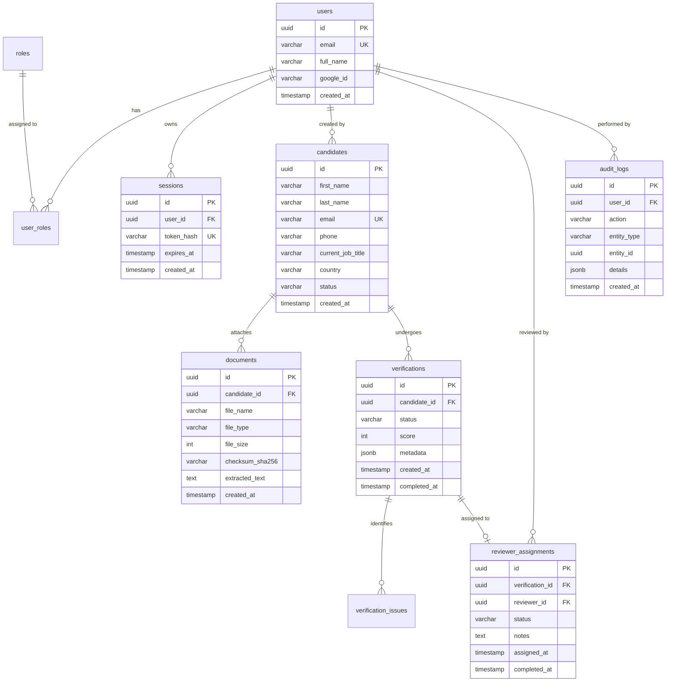
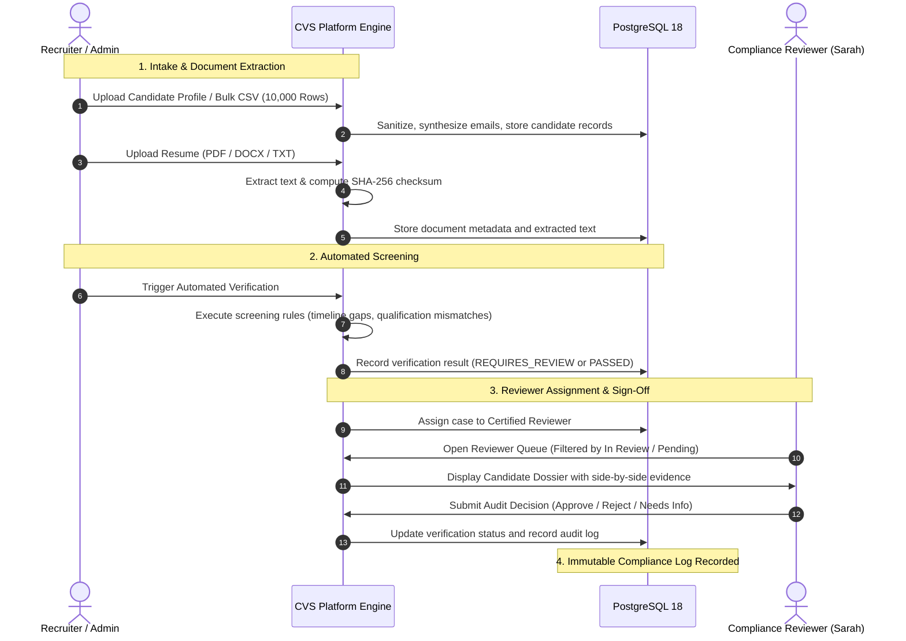

# Candidate Verification System (CVS)
## Enterprise Candidate Verification & Compliance Governance Platform

---

## 1. Executive Summary

**Candidate Verification System (CVS)** is a high-integrity, production-oriented background screening and compliance platform. Engineered with clean architecture and zero-trust security principles, CVS unifies high-volume applicant intake, automated background screening, anomaly detection, and accountable human compliance review sign-offs.

### Key Capabilities
- **Dual-Service Enterprise Topology:** High-performance Go authentication service paired with a TypeScript/Node.js candidate intelligence backend.
- **Role-Based Access Control (RBAC):** Strict operational segregation across `admin`, `recruiter`, and `reviewer` roles.
- **High-Volume Data Ingestion:** Fast streaming ingestion handling datasets of **10,000+ candidate records** with automatic deduplication and profile synthesis.
- **Multi-Format Resume Extraction:** Parsing of PDF, DOCX, and TXT resumes with SHA-256 cryptographic integrity verification.
- **Automated Screening Engine:** Rules-based discrepancy checking, employment timeline continuity analysis, and anomaly flagging.
- **Reviewer Compliance Queue:** Independent audit workflow allowing certified compliance specialists to review evidence side-by-side and submit binding audit decisions.
- **Immutable Audit Logging:** Tamper-evident, chronological logging of all state transitions, role actions, and document accesses.

---

## 2. System Architecture & Topology

The platform operates as a dual-service architecture sharing a unified PostgreSQL relational database:



### Communication Flow
1. **User Authentication:** Handled by Go Auth via Google OAuth 2.0 (OIDC PKCE) or enterprise workspace session delegation. An encrypted HTTP-only session cookie (`session_token`) is issued.
2. **Session Verification:** Node.js API verifies active sessions against the shared `sessions` table in PostgreSQL, extracting user roles (`admin`, `recruiter`, `reviewer`).
3. **Application Workflows:** The frontend interacts with Node.js REST endpoints for candidate creation, resume processing, automated verification checks, and reviewer queue decisions.
4. **Audit Trail:** Every mutating action triggers a persistent, immutable audit record linked to the acting user.

---

## 3. Directory & Codebase Structure

```
CandidateVerificationSystem/
├── database/                    # PostgreSQL schema migrations and seed scripts
│   ├── migrations/              # 001 - 016 sequential SQL migrations
│   │   ├── 001_create_users.sql
│   │   ├── 002_create_roles.sql
│   │   ├── 003_create_candidates.sql
│   │   ├── 004_create_documents.sql
│   │   ├── 005_create_verifications.sql
│   │   ├── 006_create_sessions.sql
│   │   ├── 007_create_import_batches.sql
│   │   ├── 008_create_audit_logs.sql
│   │   └── ... (009 - 016 schema enhancements & indexes)
│   └── seeds/                   # Seed users (Admin, Recruiter, Reviewer) and test profiles
│
├── go-auth/                     # Go Authentication Service (Port 8080)
│   ├── cmd/server/main.go       # Go application entry point
│   ├── internal/
│   │   ├── config/              # Environment & OAuth configuration
│   │   ├── database/            # pgxpool connection manager
│   │   ├── handlers/            # HTTP handlers (Login, Callback, Logout, Me, Roles)
│   │   ├── middleware/          # Security headers, logging, CORS
│   │   ├── models/              # User, Role, Session structs
│   │   ├── repository/          # SQL queries for users and sessions
│   │   └── services/            # OIDC token validation, session generator
│   └── tests/                   # 27 Go unit & integration test cases
│
├── node-api/                    # Node.js + TypeScript REST API (Port 3000)
│   ├── src/
│   │   ├── config/              # Database pool, environment variables, multer limits
│   │   ├── controllers/         # Request handling & HTTP response mapping
│   │   │   ├── auth.controller.ts
│   │   │   ├── candidate.controller.ts
│   │   │   ├── document.controller.ts
│   │   │   ├── verification.controller.ts
│   │   │   ├── reviewer.controller.ts
│   │   │   └── import.controller.ts
│   │   ├── services/            # Core business logic
│   │   │   ├── candidate.service.ts
│   │   │   ├── document.service.ts
│   │   │   ├── extraction.service.ts      # PDF, DOCX, TXT text extraction
│   │   │   ├── verification.service.ts    # Rule-based verification engine
│   │   │   ├── reviewer.service.ts        # Assignment & review workflows
│   │   │   └── csvIngestion.service.ts    # Streaming 10k+ CSV ingestion
│   │   ├── repositories/        # Database access layer (SQL)
│   │   │   ├── candidate.repository.ts
│   │   │   ├── document.repository.ts
│   │   │   ├── verification.repository.ts
│   │   │   ├── audit.repository.ts
│   │   │   └── user.repository.ts
│   │   ├── middleware/          # Middleware pipeline
│   │   │   ├── auth.middleware.ts         # Session cookie authentication
│   │   │   ├── rbac.middleware.ts         # Role enforcement (requireRoles)
│   │   │   ├── upload.middleware.ts       # Multer file upload validation
│   │   │   ├── validator.middleware.ts    # Zod schema validation
│   │   │   └── errorHandler.ts            # Centralized error formatting
│   │   ├── validators/          # Zod input schemas
│   │   ├── types/               # TypeScript interfaces & domain types
│   │   └── tests/               # 161 automated unit & integration tests
│   ├── tsconfig.json            # TypeScript build configuration
│   └── package.json
│
├── frontend/                    # Industrial Editorial Web Application
│   ├── index.html               # Platform landing page & architecture overview
│   ├── login.html               # Authentication & single-click role selector
│   ├── dashboard.html           # Admin Executive Telemetry & Candidate Stream
│   ├── candidates.html          # Candidate Operations Directory (Search, Add, Import)
│   ├── candidate-detail.html    # Full Verification Dossier & Evidence Evaluation
│   ├── reviewer.html            # Compliance Reviewer Assigned Queue
│   ├── docs.html                # Platform & Workflow Documentation Guide
│   ├── css/
│   │   └── design-system.css    # CVS design tokens, dark slate palette, typography
│   └── js/
│       ├── api.js               # Typed client-side API SDK
│       ├── app.js               # Global session watcher, toasts, role switching
│       └── background-scene.js  # Ambient 3D canvas backdrop
│
├── datasets/                    # Sample high-volume applicant datasets
│   ├── job_applicant_dataset.csv# 10,000 real-world candidate rows
│   └── Resume.csv               # 2,484 full-text candidate resume records
│
├── uploads/resumes/             # Uploaded resume files (PDF, DOCX, TXT)
└── docs/                        # Specifications, API guides, and phase reports
```

---

## 4. Database Schema & Data Models

PostgreSQL serves as the single source of truth with strict relational integrity, foreign key cascades, and performance indexing.



---

## 5. How It Works: The 6-Stage Operational Lifecycle



### Stage 1: Authentication & Role-Based Access Control (RBAC)
- **Google OAuth 2.0 & Workspace Session Selector:** Users sign in securely via Google OAuth 2.0 with PKCE or select authorized workspace test roles.
- **Role Privileges:**
  - `admin`: Full system governance, batch imports, reviewer assignments, metrics inspection.
  - `recruiter`: Candidate onboarding, resume document uploads, initiating verification checks.
  - `reviewer`: Personal assigned compliance queue, evidence dossier inspection, legally binding audit sign-offs.

### Stage 2: Candidate Onboarding & High-Volume CSV Ingestion
- **Manual Intake:** Instant candidate profile creation with automated phone and email normalization.
- **Batch CSV Ingestion:** Optimized streaming reader that parses high-volume datasets (e.g. `job_applicant_dataset.csv` with 10,000+ applicants) in batches:
  - Automatically synthesizes unique applicant email addresses when datasets lack email columns.
  - Deduplicates records and generates clean profiles without memory exhaustion.

### Stage 3: Resume Ingestion & Cryptographic Extraction
- Upload resumes in **PDF**, **DOCX**, or **TXT** format (up to 100MB).
- Text extraction pipeline parses applicant work history, job roles, contact info, and education.
- Generates a **SHA-256 cryptographic checksum** for every document to guarantee tamper prevention.

### Stage 4: Automated Verification Screening Engine
- The rules engine cross-examines applicant claims against extracted resume evidence:
  - **Qualification Matching:** Compares declared job role against resume history.
  - **Timeline Continuity:** Identifies unverified employment gaps exceeding regulatory thresholds.
  - **Discrepancy Flags:** Flags conflicting contact information or suspicious profile inconsistencies.
- Calculates an automated score and transitions status to `PASSED`, `FLAGGED`, or `REQUIRES_REVIEW`.

### Stage 5: Compliance Reviewer Queue & Audit Sign-Off
- Cases flagged for human evaluation are routed to the assigned Reviewer Queue.
- Certified Compliance Reviewers inspect the applicant's complete dossier:
  - Live side-by-side view of candidate claims versus extracted resume text.
  - Downloadable original resume file.
  - Chronological breakdown of automated anomaly flags.
- Reviewer submits a formal audit determination:
  - **Approved (Passed):** Candidate cleared for hiring.
  - **Rejected (Failed):** Verification rejected with documented non-compliance rationale.
  - **Needs Info (Pending):** Additional documentation requested from the applicant.

### Stage 6: Immutable Audit Trail & Regulatory Governance
- Every state transition, reviewer action, document access, and automated test execution is written to the `audit_logs` table.
- Stores operator identity, action name, entity ID, previous/new state, and timestamp.
- Ensures total defensibility for ISO and regulatory compliance audits.

---

## 6. Core REST API Route Reference

| Method | Endpoint | Description | Role Required |
|---|---|---|---|
| `GET` | `/api/v1/auth/me` | Fetch active user profile, roles, and session TTL | Authenticated |
| `GET` | `/api/v1/candidates` | List candidates with pagination and country filtering | `admin`, `recruiter`, `reviewer` |
| `POST` | `/api/v1/candidates` | Register a new candidate profile | `admin`, `recruiter` |
| `GET` | `/api/v1/candidates/:id` | Get full candidate profile and verification summary | `admin`, `recruiter`, `reviewer` |
| `GET` | `/api/v1/candidates/stats` | Get candidate counts, pending verifications, and parsing rates | `admin`, `recruiter` |
| `POST` | `/api/v1/candidates/import` | High-volume batch CSV upload and preview | `admin` |
| `POST` | `/api/v1/candidates/:id/documents` | Upload candidate resume (PDF, DOCX, TXT) | `admin`, `recruiter` |
| `GET` | `/api/v1/candidates/:id/documents` | List uploaded candidate documents & extracted text | `admin`, `recruiter`, `reviewer` |
| `GET` | `/api/v1/documents/:id/download` | Download original binary resume file | `admin`, `recruiter`, `reviewer` |
| `POST` | `/api/v1/candidates/:id/verifications` | Run automated background screening rules | `admin`, `recruiter` |
| `GET` | `/api/v1/candidates/:id/verifications` | Get verification results and anomaly issues | `admin`, `recruiter`, `reviewer` |
| `GET` | `/api/v1/reviewer/assignments` | List reviewer assigned queue with status filter | `reviewer`, `admin` |
| `POST` | `/api/v1/reviewer/assignments/:id/decision` | Submit binding audit decision (Approve/Reject) | `reviewer`, `admin` |

---

## 7. Security, Privacy & Integrity Protocols

1. **Zero-Trust Token Management:** Sessions are stored as cryptographic SHA-256 hashes in PostgreSQL. Plaintext session tokens exist only in secure HTTP-only cookies on the client browser.
2. **Session Lifespan & Renewal:** Sessions enforce a strict 30-minute rolling TTL. Client activity resets the expiration timestamp; idle sessions expire automatically.
3. **Cryptographic Document Integrity:** Every uploaded document is hashed with SHA-256 upon reception. Any file tampering is instantly detectable.
4. **Data Sanitization & Privacy:** All input data is strictly validated via Zod schemas. Public pages omit internal ports, technology engines, and database versioning.
5. **Role Segregation:** Recruiter operations cannot modify or approve compliance reviews; compliance reviewers cannot alter candidate raw profiles or administrative system settings.

---

## 8. Local Setup & Execution Guide

### Prerequisites
- **PostgreSQL 18** running locally on port `5432` with database `candidate_verification`.
- **Node.js 20+** and **npm**.
- **Go 1.22+**.

### Step 1: Initialize Database
```bash
# Apply migrations sequentially
psql -U postgres -d candidate_verification -f database/migrations/001_create_users.sql
psql -U postgres -d candidate_verification -f database/migrations/002_create_roles.sql
# ... apply migrations 003 through 016

# Apply seed data
psql -U postgres -d candidate_verification -f database/seeds/001_seed_initial_data.sql
```

### Step 2: Start Go Authentication Service
```bash
cd go-auth
go run ./cmd/server
# Go Auth listening on http://localhost:8080
```

### Step 3: Start Node.js API & Frontend Server
```bash
cd node-api
npm install
npm run dev
# Node.js API and Web Console listening on http://localhost:3000
```

### Step 4: Access the Web Console
Open your browser to:
- **Landing Page:** [http://localhost:3000](http://localhost:3000)
- **Sign In:** [http://localhost:3000/login.html](http://localhost:3000/login.html)
- **Admin Dashboard:** [http://localhost:3000/dashboard.html](http://localhost:3000/dashboard.html)
- **Candidates Directory:** [http://localhost:3000/candidates.html](http://localhost:3000/candidates.html)
- **Reviewer Queue:** [http://localhost:3000/reviewer.html](http://localhost:3000/reviewer.html)
- **Platform Documentation:** [http://localhost:3000/docs.html](http://localhost:3000/docs.html)

### Step 5: Run Automated Test Suites
```bash
# Run Node.js test suite (161 tests)
npm --prefix node-api test

# Run Go Auth test suite (27 tests)
cd go-auth && go test ./...
```
