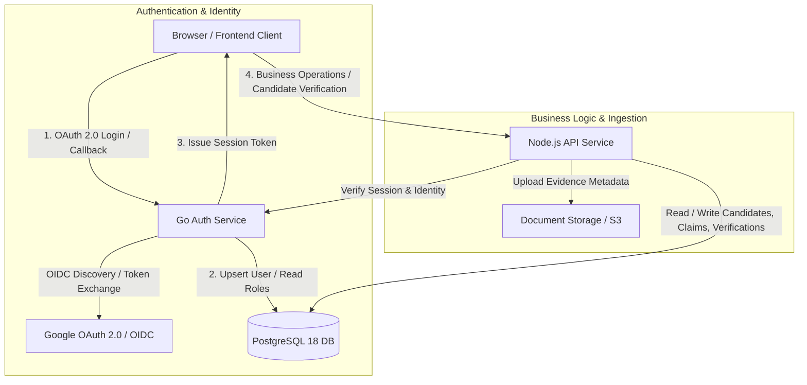

# System Architecture: Candidate Verification System

## 1. Overview
The **Candidate Verification System** is an enterprise-grade platform for automating and managing background verification workflows for job candidates.

The architecture decouples authentication and identity management from business logic and data processing:
- **Go Authentication Service (`go-auth`)**: Handles Google OAuth 2.0 / OpenID Connect (OIDC), PKCE, and session token verification.
- **PostgreSQL 18 (`candidate_verification`)**: Centralized relational data store with 11 core tables, strong constraints, and immutable audit logs.
- **Node.js / Express API (`node-api`)**: Candidate lifecycle management, CSV import processing, document verification workflows, and business validation rules (Future Phase).

---

## 2. Architecture Diagram

---

## 5. Node.js Express API Service
- **Runtime:** Node.js 26+ with TypeScript (ES2022)
- **Framework:** Express 4.x with Helmet, CORS, and Pino structured logging
- **Configuration:** Zod schema-enforced environment parsing
- **Database Driver:** `pg` (`Pool`) reusing shared `candidate_verification` database
- **Documentation:** Interactive OpenAPI 3.0 / Swagger UI at `/api/v1/docs`
