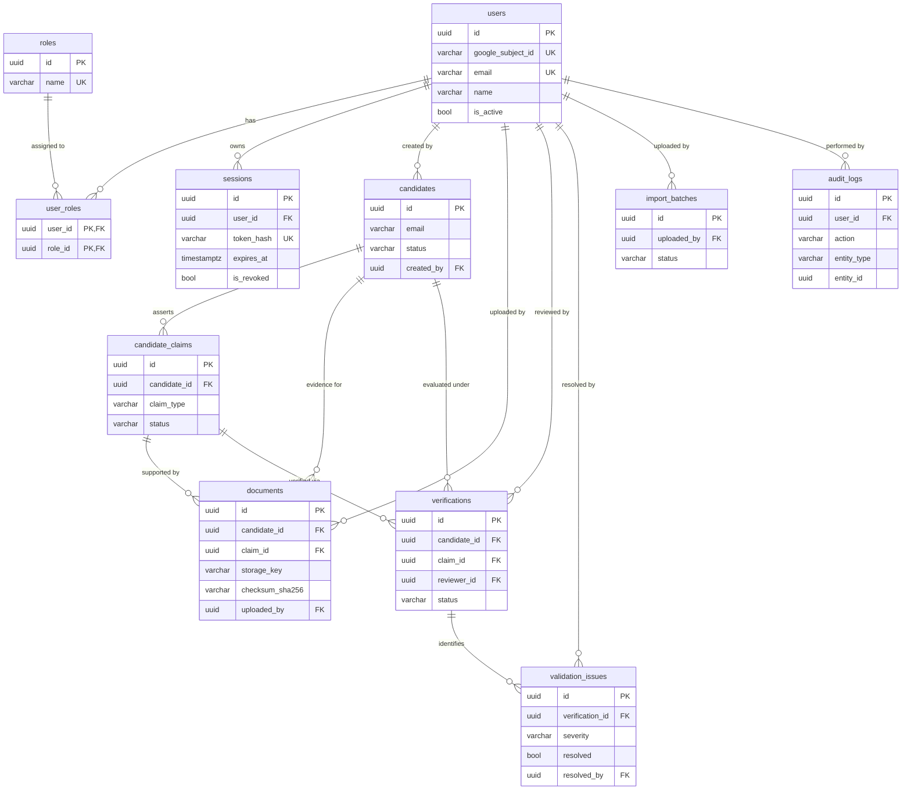

# Database Relationships & Entity-Relationship Model

This document outlines the entity relationships, cascade behaviors, and foreign key mappings across all 11 tables in the **Candidate Verification System**.

---

## 1. Entity-Relationship Diagram

---

## 2. Foreign Key & Cascade Rules

| Parent Table | Child Table | Foreign Key Column | On Delete Action | Rationale |
| :--- | :--- | :--- | :--- | :--- |
| `users` | `user_roles` | `user_id` | `CASCADE` | Deleting a user cleans up their role bindings. |
| `roles` | `user_roles` | `role_id` | `CASCADE` | Removing a role revokes it from all assigned users. |
| `users` | `sessions` | `user_id` | `CASCADE` | Deleting a user immediately terminates all active sessions. |
| `users` | `candidates` | `created_by` | `SET NULL` | Preserves candidate records even if the creating recruiter leaves. |
| `users` | `documents` | `uploaded_by` | `SET NULL` | Preserves evidence metadata for compliance. |
| `users` | `verifications`| `reviewer_id`| `SET NULL` | Maintains verification record while disassociating removed reviewer. |
| `users` | `import_batches`| `uploaded_by`| `SET NULL` | Preserves CSV import history. |
| `users` | `audit_logs` | `user_id` | `SET NULL` | Immutable audit trails remain intact forever. |
| `candidates` | `candidate_claims` | `candidate_id` | `CASCADE` | Deleting a candidate removes their claims. |
| `candidates` | `documents` | `candidate_id` | `CASCADE` | Deleting a candidate removes their document metadata. |
| `candidates` | `verifications` | `candidate_id` | `CASCADE` | Deleting a candidate clears their verification attempts. |
| `candidate_claims` | `documents` | `claim_id` | `SET NULL` | Deleting a claim does not delete candidate documents. |
| `candidate_claims` | `verifications` | `claim_id` | `CASCADE` | Removing a claim removes pending verification records. |
| `verifications` | `validation_issues` | `verification_id` | `CASCADE` | Deleting a verification clears its flagged issues. |

---

## 3. Key Relationships & Cardinality

1. **Users & Roles (`M:N`):**
   - Implemented via `user_roles` junction table.
   - Users can hold multiple roles simultaneously (e.g. both `recruiter` and `reviewer`).
2. **Users & Sessions (`1:N`):**
   - Supports concurrent sessions across devices (desktop, mobile).
   - Instant revocation via `is_revoked = true` or `DELETE FROM sessions WHERE user_id = ...`.
3. **Candidates & Claims (`1:N`):**
   - Each candidate can have multiple claims across categories (e.g., 2 employment claims, 1 education claim, 1 identity claim).
4. **Claims & Documents (`1:N`):**
   - A claim can be substantiated by multiple documents (e.g., degree certificate, academic transcript).
5. **Claims & Verifications (`1:1` or `1:N`):**
   - Tracks each review cycle for a given claim. If a claim is resubmitted after rejection, new verification cycles can be created.
6. **Verifications & Validation Issues (`1:N`):**
   - A single verification evaluation can flag multiple specific discrepancies with severity levels (`low`, `medium`, `high`, `critical`).
